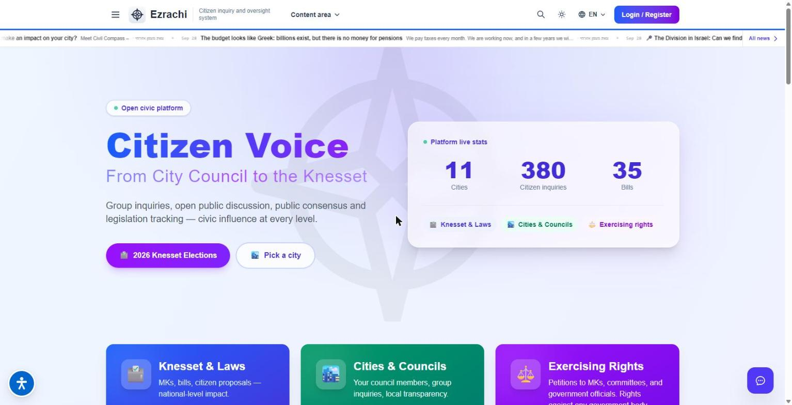
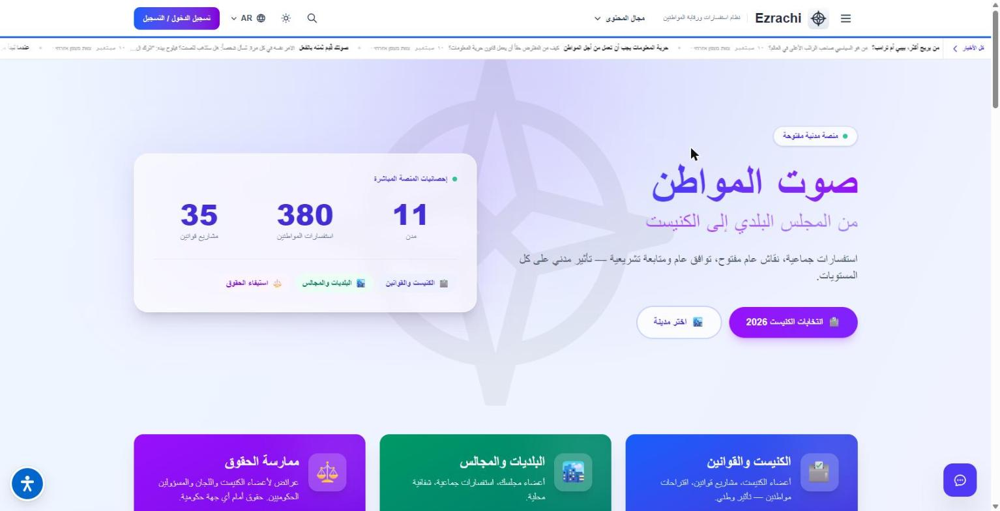

https://github.com/user-attachments/assets/2e51dd05-e406-4519-a2ff-180f4d6ecbe3

# Case study: a design system for a live multilingual civic-tech site

- **Project:** Civic Compass (מצפן אזרחי): https://www.amechad.info
- **Role:** volunteer front-end developer, Sep 2026 – present
- **Stack:** SvelteKit 2 (Svelte 5 runes) · Tailwind CSS 4 · svelte-i18n · Playwright
- **Scope:** front-end only. The Strapi/PostgreSQL backend belongs to another team member.

**Demo video (2 min, no sound):** live site, light → dark theme, all 5 languages, RTL ↔ LTR.

## The problem

Civic Compass helps residents of 11 Israeli cities follow their local council and the Knesset.
It runs in 5 languages (Hebrew, Arabic, English, Russian, French), so it has to work both
right-to-left and left-to-right. The brief I got was one line: *improve layout, UX, visual
hierarchy and consistency of typography, colour and navigation.*

First I measured the code (135 Svelte components, ~53k lines):

- **No design layer at all.** Tailwind 4 with zero theme tokens. 18 colour families in use
  (gray and slate both used as "neutral", indigo and blue both as "primary", three greens),
  60+ hard-coded hex colours, 11 font sizes with no roles, 11 different page widths.
- **RTL broken at the root.** `direction: rtl` was hard-coded on `<body>`, so the footer and
  the support widget stayed right-to-left in English, French and Russian
  (punctuation visibly flipped). Physical spacing (`ml-*`, `text-right`) outnumbered
  logical spacing ~15:1.
- **Dark mode half-built.** Only 35 of 135 components had any dark styling; some pages
  ignored the theme toggle completely.
- **No shared components.** ~590 raw `<button>`s, 11 separately written modals,
  8 separately written cards, 15 routes with a `<main>` nested inside `<main>`.

## What I built

1. **Foundation, with no visual change.** Removed duplicate CSS that was silently breaking
   dark borders; moved text direction to `<html dir>` driven by the active language, so
   every region (header, main, footer, widgets) follows the locale.
2. **A token layer** in Tailwind 4 `@theme`: semantic colours (brand, surface, border, text,
   success / warning / danger / info, each with a light and a dark value), typography roles
   (display, h1–h4, body, caption, label), radius, shadow and spacing roles. Dark mode
   became a token swap instead of hundreds of `dark:` classes.
3. **Primitives.** Layout primitives (`Page`, `Section`, `Stack`, `Cluster`, `Grid`), then
   twelve shared UI components (Button, Card, Modal with focus trap / Esc / scroll lock,
   Input / Select / Textarea / FormField with one label-error-hint contract, Badge, Alert,
   Spinner, EmptyState, Avatar), all RTL-safe and checked in both themes on a live
   `/design` reference page. 47 files now build on them.
4. **Rollout, end-user pages first**, across ~30 pages: home, city pages, Knesset proposals,
   the neighbourhood map, inquiries, games and leaderboards, about/partners and more.
   Each page went from hard-coded colours to tokens and was checked in light and dark,
   on desktop and at 390 px phone width, in the relevant languages.

**In numbers:** 229 commits, 200 of them already merged to production;
~16,600 lines added and ~7,700 removed across ~690 files.

## Accessibility and quality

- Text contrast measured and fixed to WCAG AA (4.5:1) in both themes. Examples:
  bottom navigation tabs 2.62 → 4.75 (light) and 3.77 → 6.83 (dark); status colours on
  their own tint went from as low as 2.06 to 9.7–16.3.
- Unlabelled form controls cut from 51 to 21.
- I wrote small Playwright QA tools: a console-error gate, a geometry probe (overlap,
  horizontal overflow, clipped text) and a **modal smoke test: 238 cases across 20 dialogs,
  all passing**. It found and helped fix real defects: lost focus after closing an editor,
  a recipient list reversed in LTR languages, tabs cut off at 390 px.
- Every batch went through a written pre-merge QA round before it reached staging.

## How I work

- Measure first, change second, measure again: every claim above comes from a grep,
  a contrast measurement or a test run, not from eyeballing.
- Small commits on my own branch, QA round, then staging, then the maintainer merges
  to production.
- AI-assisted (Claude Code) for analysis and code. I direct the work, review every change,
  and run the QA myself before anything is merged.

## What I'd show in an interview

The token layer and how one `.dark` class re-themes a whole page; the RTL fix; and the
QA harness that caught bugs the type-checker could not.
